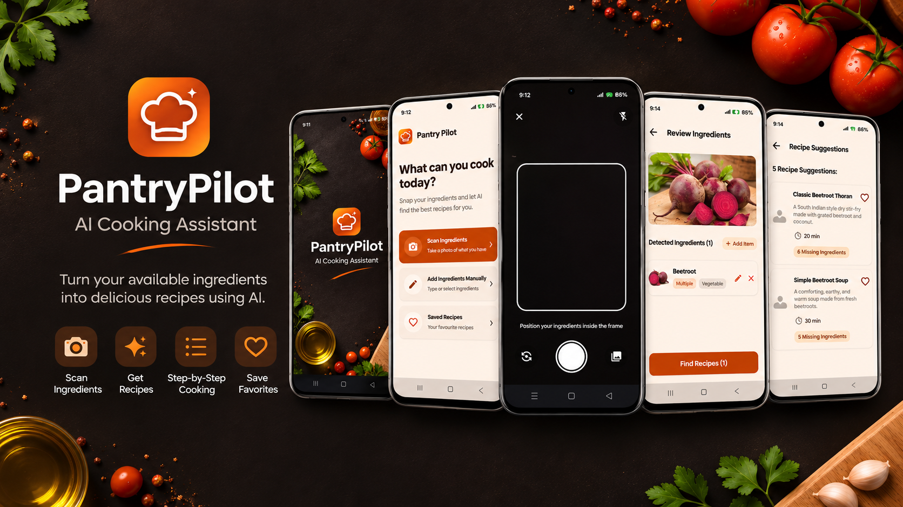
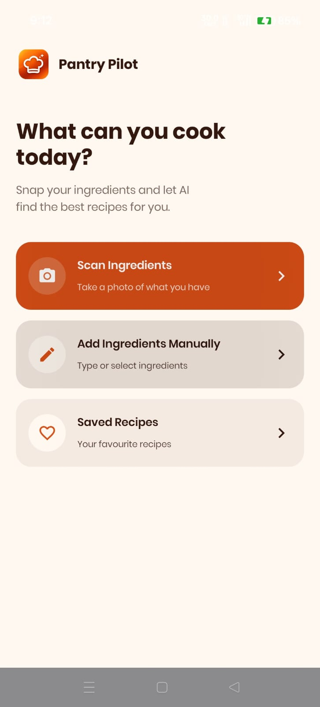
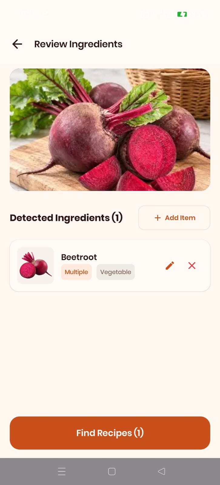
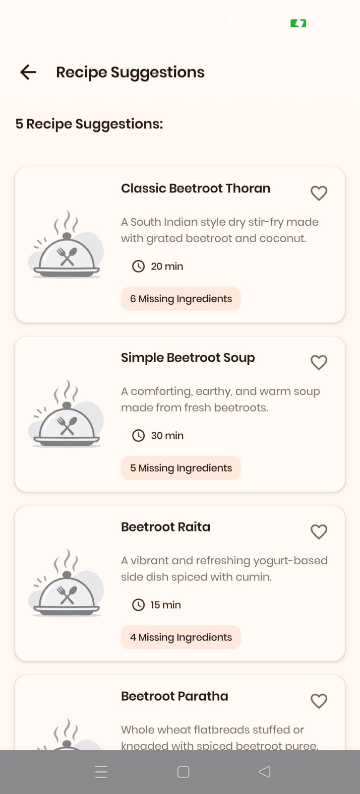
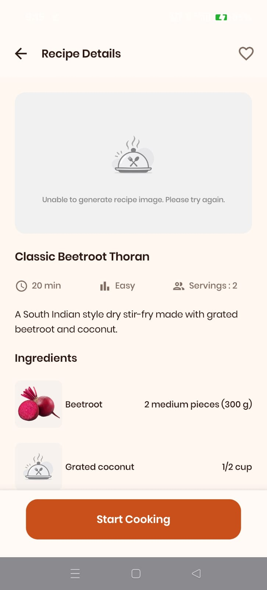
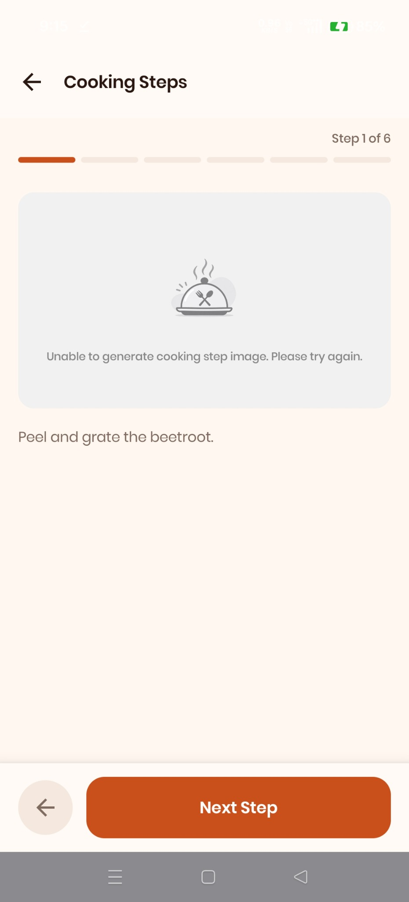
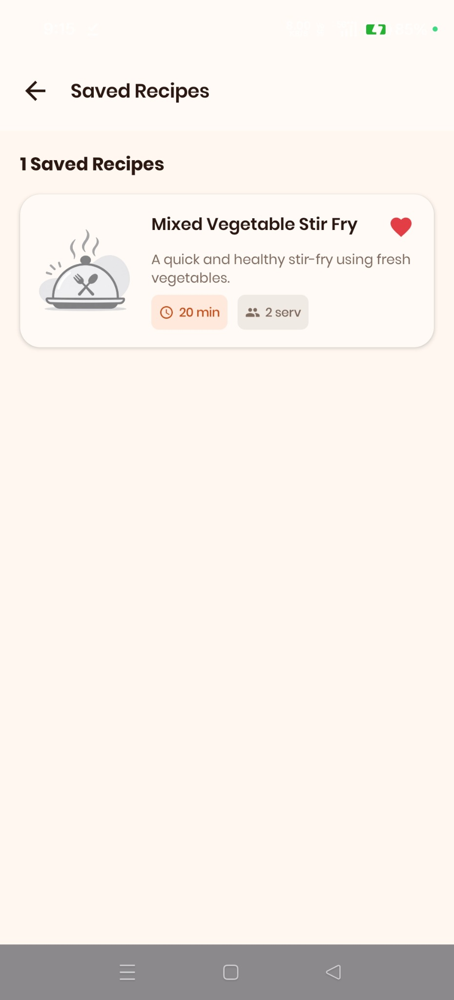
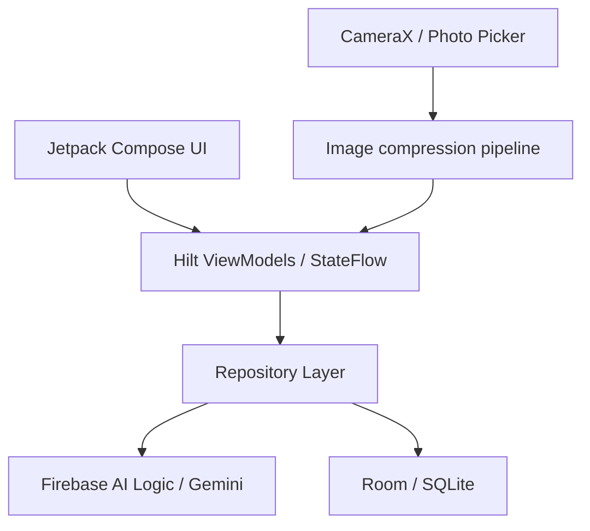

<div align="center">
  

  <h1>PantryPilot</h1>
  <p><strong>An AI-powered cooking assistant for Android.</strong></p>
  <p>Scan the ingredients you have, discover recipes you can make, and follow the cooking process step by step.</p>

  <p>
    
    
    
    
    
  </p>
</div>

---

## About

PantryPilot is a native Android project built around a simple question:

**What can I cook with the ingredients I already have?**

Users can take a photo of ingredients or choose an image from their gallery. PantryPilot sends an optimized image to Google Gemini through Firebase AI Logic and displays the detected ingredients for review. After confirming the list, users can generate recipe suggestions, check ingredient quantities and missing items, and follow cooking instructions one step at a time.

Favourite recipes are stored locally using Room, so saved recipes can be opened without an internet connection. Ingredient recognition and recipe generation require an active internet connection.

## Screenshots

The screenshots below are captured from the running app.

<div align="center">
  <table>
    <tr>
      <td align="center" width="33%">
        <br />
        <strong>Home</strong>
      </td>
      <td align="center" width="33%">
        <br />
        <strong>Ingredient review</strong>
      </td>
      <td align="center" width="33%">
        <br />
        <strong>Recipe suggestions</strong>
      </td>
    </tr>
    <tr>
      <td align="center" width="33%">
        <br />
        <strong>Recipe details</strong>
      </td>
      <td align="center" width="33%">
        <br />
        <strong>Cooking steps</strong>
      </td>
      <td align="center" width="33%">
        <br />
        <strong>Saved recipes</strong>
      </td>
    </tr>
  </table>
</div>

## Features

- **Ingredient scanning:** Capture a photo with CameraX or select one using the Android Photo Picker.
- **Image optimization:** Downsample images to a maximum dimension of 1024 px, correct EXIF orientation, and encode as JPEG before AI processing.
- **Ingredient review:** Review detected ingredients, edit or remove items, and add ingredients manually.
- **AI recipe discovery:** Generate recipe suggestions based on confirmed ingredients, including cooking time, difficulty, servings, quantities, and missing ingredients.
- **Guided cooking:** Follow cooking instructions one step at a time with progress and previous/next navigation.
- **Saved recipes:** Store favourite recipes in a local Room database and observe updates through Kotlin Flow.
- **Graceful image fallback:** Recipe details and cooking instructions remain available when optional AI image generation is unavailable.

## Architecture

The app uses a layered, repository-based structure with unidirectional data flow (UDF).



### Main responsibilities

- **Presentation:** Compose screens and reusable components render UI state and send user actions.
- **ViewModels:** Hilt-managed ViewModels coordinate app operations and expose state through `StateFlow`.
- **Remote AI:** Firebase AI Logic sends image and text prompts to Gemini for ingredient recognition and recipe generation.
- **Local storage:** Room stores saved recipes. DAO queries expose reactive `Flow` streams.
- **Media pipeline:** CameraX and Android Photo Picker provide images; the image utility downsamples, corrects orientation, and compresses them before AI processing.

## Tech stack

| Area | Technology |
|---|---|
| Language | Kotlin |
| UI | Jetpack Compose, Material 3 |
| AI integration | Firebase AI Logic, Google Gemini |
| Dependency injection | Dagger Hilt |
| Local persistence | Room, SQLite |
| Camera and media | CameraX, Android Photo Picker |
| Asynchronous work | Kotlin Coroutines, Flow, StateFlow |
| Image loading | Coil 3 |
| Serialization | Gson |
| Testing | JUnit; Room converter tests |

## Project structure

```text
com.pantrypilot.app/
├── data/
│   ├── local/
│   │   ├── converters/       # Room type converters
│   │   ├── dao/              # Room DAOs
│   │   ├── entity/           # Room entities
│   │   └── AppDatabase.kt
│   ├── model/                # Ingredient and recipe models
│   ├── remote/               # Firebase AI / Gemini repositories
│   └── repository/           # Saved-recipe repository
├── di/                       # Hilt dependency injection modules
├── ui/
│   ├── components/           # Reusable Compose components
│   ├── navigation/           # NavHost, routes and transitions
│   ├── screens/              # App screens
│   └── theme/                # Colours, typography and shapes
└── util/                     # Image compression and utilities
```

## Getting started

### Requirements

- Android Studio with Android SDK support
- JDK 17 or newer
- Android device or emulator (minimum API 24)
- A Firebase project with Firebase AI Logic configured

### 1. Clone the repository

```bash
git clone https://github.com/<your-github-username>/PantryPilot.git
cd PantryPilot
```

Replace `<your-github-username>` with the GitHub account or organization that hosts the repository.

### 2. Configure Firebase

1. Create a project in the [Firebase Console](https://console.firebase.google.com/).
2. Register an Android app with the package name `com.pantrypilot.app`.
3. Enable and configure Firebase AI Logic with the Gemini backend used by the app.
4. Download `google-services.json` and place it inside the `app/` directory:

   ```text
   PantryPilot/app/google-services.json
   ```

5. Configure Firebase App Check for your Firebase project. Use the Debug provider for local development and register the debug token in the Firebase Console. For distributed builds, configure an appropriate attestation provider and register the signing certificate as required by that provider.

> **Security:** Do not commit `keystore.properties`, keystore files, signing passwords, service-account credentials, or Firebase App Check debug tokens. Use your own Firebase project configuration when building the app. Restrict API usage appropriately.

### 3. Build and run

Open the project in Android Studio, allow Gradle sync to complete, and run the `app` configuration on a device or emulator.

You can also build from the command line.

**macOS / Linux**
```bash
./gradlew assembleDebug
./gradlew testDebugUnitTest
```

**Windows**
```bat
gradlew.bat assembleDebug
gradlew.bat testDebugUnitTest
```

## Current limitations

- Ingredient recognition can be affected by lighting, image quality, occlusion, and overlapping ingredients. Users should review the detected list before generating recipes.
- Recipe suggestions, quantities, and cooking instructions are AI-generated and may need correction or user judgement.
- Ingredient recognition and recipe generation require an internet connection. Only recipes already saved locally are available offline.
- AI response times vary with network conditions, image size, service availability, and model load.
- Recipe-cover and cooking-step image generation depends on model availability and usage quotas. Placeholder images are displayed when generation is unavailable.
- Ingredient substitution is not included in the current version.

## License

This project is licensed under the MIT License. See [LICENSE](LICENSE) for details.
